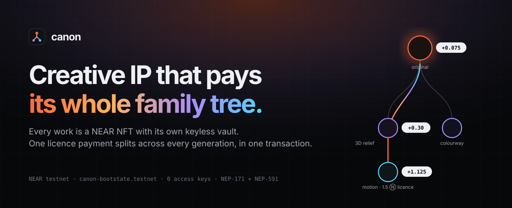
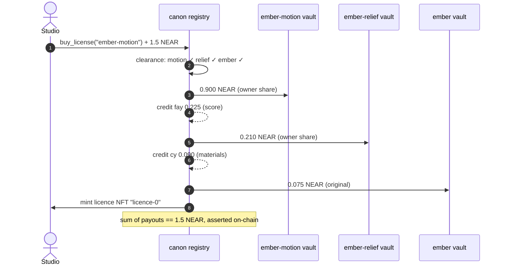
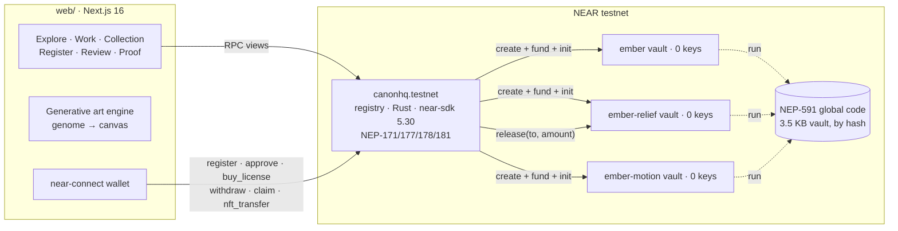

<p align="center">
  
</p>

<p align="center">
  <a href="https://testnet.nearblocks.io/address/canonhq.testnet"></a>
  
  
  <a href="JUDGES.md"></a>
  
  <a href="LICENSE"></a>
</p>

# Canon

**Every creative work is a NEAR NFT that owns its own keyless wallet. When a studio licenses a derivative, one
payment splits up the entire family tree (original artist, 3D sculptor, animator, every contributor) in a
single transaction.**

Built at **NEAR HACKATHON 2026** for **Track 10 · NFTs That Do Something** by Bootstate.

| | |
|---|---|
| **Registry contract** | [`canonhq.testnet`](https://testnet.nearblocks.io/address/canonhq.testnet) · NEP-171 / 177 / 178 / 181 / 199 · **0 access keys** |
| **Vault code** | 3.5 KB `no_std` contract, published as an immutable NEP-591 global contract · hash `Anq6HuuCn243gdRdBjudqvR1uCe8NB8JQzTD5DF9KKtw` |
| **Proof** | [JUDGES.md](JUDGES.md): 41 real testnet transactions, including **11 attacks the contract refused** |
| **Security** | [THREAT_MODEL.md](THREAT_MODEL.md): 27 attacks → defence → error code → test |
| **App** | Next.js 16 · reads and writes the live registry · [run it in 2 commands](#run-it) |

---

## What the NFT does

A normal NFT records who owns a picture. A Canon NFT **is an account with money and rules**:

| The NFT… | How | Proof |
|---|---|---|
| **owns a wallet** | Each work gets a sub-account `<work>.canonhq.testnet` with **no access keys**, running the shared vault code | [`ember-motion.canonhq.testnet`](https://testnet.nearblocks.io/address/ember-motion.canonhq.testnet) |
| **earns from its descendants** | Every licence of a derivative sends a share upstream to each ancestor's vault | [licence tx `HrgXyS…`](https://testnet.nearblocks.io/txns/HrgXySX1m4uHA21ynYgLrCvCBxJNg2n8syFSWGAm8U2a) |
| **carries rights** | Derivatives exist only with the parent owner's on-chain approval; clearance walks every ancestor | [refused `ERR_NOT_CLEARED`](https://testnet.nearblocks.io/txns/4bSvXfN9AWuoMbN4mmzS8rMB71nwfDGqzngQRN9czHwQ) |
| **moves money with ownership** | Sell the NFT and its vault, plus all future income, goes to the buyer; the seller is locked out | [seller refused `ERR_NOT_OWNER`](https://testnet.nearblocks.io/txns/BV24rL8mdsXAFYFPsUEYngqGXhSsUEECWc1dr57BkRu3) → [buyer withdraws](https://testnet.nearblocks.io/txns/663gSSN18Rz6ZTwjgr1pzdC7xBVSDbkQnV6W6GXnztyc) |
| **earns on resale** | NEP-199 `nft_payout` / `nft_transfer_payout`: any marketplace that sells a work pays every ancestor's vault its share | [sale `F2G9dc…`](https://testnet.nearblocks.io/txns/F2G9dcGT33nxmmsmCKngJ67UKQhd5c3rD9i2Dq1vBDVo) → [royalty into Ember's vault](https://testnet.nearblocks.io/txns/EbYDjVU4Jv7oVvZxJqkCWeQcpVYu22cNyph9GjMaEQgv) → [Ada withdraws it](https://testnet.nearblocks.io/txns/BKJvR3RrVDgsro4G4PRL6DWkr187VLitmSjCrzVt6GVH) |
| **shows its art anywhere** | Token `media` is a hosted 1024 px image, so wallets and explorers render it | [`docs/art/`](docs/art) |
| **is a key** | The studio receives a **licence NFT**; holding it unlocks the source files, and it can be resold | `nft_tokens_for_owner(studio…)` → `licence-0`, `licence-1` |

## The payment, step by step

A studio licenses **Ember Field — Motion** for **1.5 Ⓝ**. One call, `buy_license`, does all of this
([transaction](https://testnet.nearblocks.io/txns/HrgXySX1m4uHA21ynYgLrCvCBxJNg2n8syFSWGAm8U2a)):



| Generation | Work | Arrives | Passes upstream | Vault (follows NFT) | Contributors (follow people) |
|---|---|---:|---:|---:|---:|
| 0 | Ember Field — Motion | 1.500 | 0.375 (25%) | 0.900 | fay 0.225 |
| −1 | Ember Field — Relief | 0.375 | 0.075 (20%) | 0.210 | cy 0.090 |
| −2 | Ember Field | 0.075 | — | 0.075 | — |
| | **Total** | | | **1.185** | **0.315** = **1.500** ✓ |

> **Asset income follows the NFT. Authorship income follows people.** The owner's share lands in the work's vault
> and changes hands with the token. Contributor shares are credited to the person and never move with a sale.

## Try it (judges)

**No wallet needed** for the first four rows. Every row works on NEAR testnet.

| Do | See |
|---|---|
| `cd web && pnpm i && pnpm dev`, open `localhost:3000` | Live hero: one licence splitting across three generations with a synced transaction log |
| **Explore** → **Ember Field — Motion** | Clearance across 3 generations · contributor splits · **The NFT** panel (contract, token ID, holder, raw `nft_token` metadata) · licences issued and who holds them · lineage graph |
| **Collection** → *Studio* demo collector | The studio's two **licence NFTs**, read with `nft_tokens_for_owner` |
| **Proof** | All 41 testnet transactions with explorer links; refused attacks highlighted |
| Connect any testnet wallet → **License** a cleared work | One `buy_license` transaction; payouts shown before you pay; licence NFT appears in your Collection; **Source file** downloads |
| **Register** → *A derivative* → pick a parent | A pending work with its own keyless vault, waiting in the parent owner's **Review** queue |
| Open **Moth Light — Fragments** | "Not cleared": its parent forbids commercial use |

### Verify on-chain yourself

```bash
near account list-keys canonhq.testnet network-config testnet now                 # → no keys
near account list-keys ember-motion.canonhq.testnet network-config testnet now    # → no keys
near contract call-function as-read-only canonhq.testnet quote_license \
  json-args '{"token_id":"ember-motion"}' network-config testnet now                       # → the split above
near contract call-function as-read-only canonhq.testnet clearance \
  json-args '{"token_id":"moth-fragments"}' network-config testnet now                     # → cleared: false + reason
near contract call-function as-read-only canonhq.testnet nft_tokens_for_owner \
  json-args '{"account_id":"studio.canonhq-demo.testnet"}' network-config testnet now
```

## Security: the refusals are on-chain

The track asks *what stops the old owner from keeping access?* Every answer below is a transaction anyone can open.

| Attack | Refused with | Transaction |
|---|---|---|
| Seller withdraws after selling the NFT | `ERR_NOT_OWNER` | [`BV24rL…`](https://testnet.nearblocks.io/txns/BV24rL8mdsXAFYFPsUEYngqGXhSsUEECWc1dr57BkRu3) |
| Seller drains the vault while the NFT is listed | `ERR_TOKEN_LISTED` | [`6825sV…`](https://testnet.nearblocks.io/txns/6825sV2P2vweDqrmfRebjBU9j413tpipeWV5G56reuvH) |
| Stranger withdraws from a vault | `ERR_NOT_OWNER` | [`AAeV3S…`](https://testnet.nearblocks.io/txns/AAeV3SwDaLqRPkaZpnYr5JVrcN1gCvNN1RgEoiuWtZMH) |
| Anyone calls a vault directly | `ERR_ONLY_REGISTRY` | [`6fxRFG…`](https://testnet.nearblocks.io/txns/6fxRFGxnNw1ws7XTRw3pEctBtmjVegZuUaYf5iqFBuKG) |
| Non-owner approves a derivative | `ERR_NOT_PARENT_OWNER` | [`HbPJrG…`](https://testnet.nearblocks.io/txns/HbPJrGFZJrUJF4K3LwbQ8xBJ1S9bfkoMFLMw1njYU1iM) |
| Licence a work with a non-commercial ancestor | `ERR_NOT_CLEARED` | [`4bSvXf…`](https://testnet.nearblocks.io/txns/4bSvXfN9AWuoMbN4mmzS8rMB71nwfDGqzngQRN9czHwQ) |
| Licence a revoked derivative | `ERR_NOT_CLEARED` | [`4goc1M…`](https://testnet.nearblocks.io/txns/4goc1MyPKzs8rak9boq7bdnSnmdMoi2fm97DeMgYpDYF) |
| Licence a pending derivative | `ERR_NOT_CLEARED` | [`6Hrqux…`](https://testnet.nearblocks.io/txns/6HrquxkqPHfyfYFmEZ12GN9LMkXewBKeiZU8skfK4bBU) |
| Derive from a closed work | `ERR_DERIVATIVES_CLOSED` | [`6S7b5n…`](https://testnet.nearblocks.io/txns/6S7b5nYG2De1rHVQMEnbqXdjoBiTrPYYrwmxQULDoctJ) |
| Splits that don't total 100% | `ERR_BAD_SPLITS` | [`GQNgq9…`](https://testnet.nearblocks.io/txns/GQNgq9VrPjEMjnA2nVdFbrHoBwFGzRz5Hr2TwKvYR7wx) |
| Claim the same earnings twice | `ERR_NOTHING_TO_CLAIM` | [`5mNeHj…`](https://testnet.nearblocks.io/txns/5mNeHjdts6zGeUpwiZs2Mn7j1vaUyJKTe15nnT2VyngB) |

Attacks that need a race (selling *during* a withdrawal) or a failure (vault creation or release failing) are
covered by unit tests: `cannot_sell_while_a_withdrawal_is_in_flight`, `cannot_withdraw_twice_concurrently`,
`failed_withdrawal_unlocks_and_keeps_the_balance`, `failed_vault_creation_rolls_back_registration`,
`quote_matches_price_exactly_for_awkward_amounts`. The full list is in [THREAT_MODEL.md](THREAT_MODEL.md).

**No master key.** The registry has no owner, pause, upgrade or override method, and its access keys were deleted
in [`Ck5zh9…`](https://testnet.nearblocks.io/txns/Ck5zh9yc4mYKkbfRndWQazufKViYokjqn7wihpsn1eKD). Vault code is
referenced by hash, so it cannot change either.

## Architecture



**Vault creation** is one batch with no `AddKey`, ever:
`CreateAccount → Transfer(0.03 Ⓝ) → UseGlobalContract(hash) → FunctionCall(new)`.
`new()` records its caller as the registry; nobody can initialise a vault first because it runs in the same receipt.

**Withdrawal** checks `caller == nft owner`, requires 1 yoctoNEAR (full-access key), refuses while the token is
listed, then **locks the token** (`nft_transfer` rejects while locked) until the vault's transfer resolves.

**Payout maths** is integer: at each generation the parent takes `upstream_bps` of what arrived, contributors take
their bps of the remainder, and the node's vault keeps the rest including rounding dust. The contract asserts the
sum equals the price.

**On-chain:** ownership, lineage, approvals, terms, splits, balances, licences, file hashes.
**Off-chain:** the artwork. Each token's `media` stores a genome (`canon:genome/4127/flow/ember/relief+motion`)
that the app renders deterministically. A derivative's genome is its parent's plus one transform, so the family
resemblance is visible. Uploaded files stay with the creator; only their SHA-256 is recorded.

### Contract API

| Method | Who | What |
|---|---|---|
| `register_work(token_id, title, …, terms, owner_bps, contributors, parent_id?)` | anyone, payable | Mint the work NFT + create its keyless vault. Originals are approved; derivatives are pending |
| `approve` / `reject` / `revoke(token_id)` | parent's current owner, 1 yN | Decide what joins the lineage |
| `clearance(token_id)` | view | One verdict for the whole lineage, with a reason per generation |
| `quote_license(token_id)` | view | Exactly who receives what |
| `buy_license(token_id, use_case)` | anyone, payable | Re-check clearance, split the payment up the tree, mint a licence NFT |
| `withdraw(token_id)` | current NFT owner, 1 yN | Move the vault balance to the owner (locked while in flight) |
| `claim()` | contributors | Collect credited shares |
| `get_work` · `get_works` · `get_licences` · `has_licence` · `get_claimable` | views | Read everything the UI shows |
| `nft_payout` / `nft_transfer_payout` | NEP-199 | Resale royalties: each ancestor's vault gets its `upstream_bps` cascade; the seller keeps the rest |
| `nft_*` | NEP-171/177/178/181 | Standard NFT interface (transfer blocked while a withdrawal is in flight) |

## Run it

```bash
# Web app: reads and writes the live testnet registry by default
cd web && pnpm install && pnpm dev                      # http://localhost:3000
# NEXT_PUBLIC_CANON_CONTRACT=<account> points at another registry; "" = preview mode with demo data

# Contracts (Linux / macOS / WSL; near-sdk 5.30 needs Rust ≥ 1.95)
cd contracts && cargo test -p canon-registry            # 41 tests
(cd vault && RUSTUP_TOOLCHAIN=1.86.0 cargo near build non-reproducible-wasm --no-abi)   # 3.5 KB
(cd registry && cargo near build non-reproducible-wasm)

# Everything from scratch: faucet accounts → deploy → seed demo story → JUDGES.md → delete registry keys
bash scripts/setup-all.sh <registry>.testnet <funder>.testnet
```

```
contracts/registry   NEP-171 registry: lineage, approvals, clearance, payouts, licences, withdrawals (+ 41 tests)
contracts/vault      no_std vault, 3.5 KB, registry-only release
web/                 Next.js app: generative art engine, live chain layer, wallet, all pages
scripts/             setup-all.sh (one shot) · deploy.sh (build, deploy, seed, ledger, lock)
JUDGES.md            every testnet transaction from the seed run
THREAT_MODEL.md      27 attacks, defences, error codes and tests
```

## Scope and design decisions

* **On-chain records are evidence, not a court.** A registration is the creator's signed declaration plus a file
  hash and a timestamp; approvals are signed by the parent's owner. That is strong, public evidence of who claimed
  and approved what, and when. Whether a claim is legally true is decided by contracts and courts, not by any
  blockchain, and Canon says so on every work rather than over-promising.
* **No admin, by design.** Nobody, including us, can move a vault's money, freeze a work or upgrade the contract.
  The trade-off is deliberate: an owner who loses their keys must recover their NEAR account through their wallet.
* **Testnet.** The rules allow testnet for every track, and it lets judges repeat every step with free faucet funds
  (demo prices are 0.2–1.5 Ⓝ). The same contracts deploy to mainnet unchanged.

## Disclosure

* **Pre-hackathon code:** none. All code was written during the hackathon; the first commit is 2026-11-12.
* **Libraries:** near-sdk, near-contract-standards, Next.js, React, Tailwind CSS, motion, lucide-react, clsx,
  tailwind-merge, @hot-labs/near-connect.
* **AI assistance:** built with Claude Code (Anthropic) as a pair programmer. The team reviewed and tested all of it
  and is responsible for it.
* **Other chains:** no existing product on another chain.

## License

[MIT](LICENSE)
